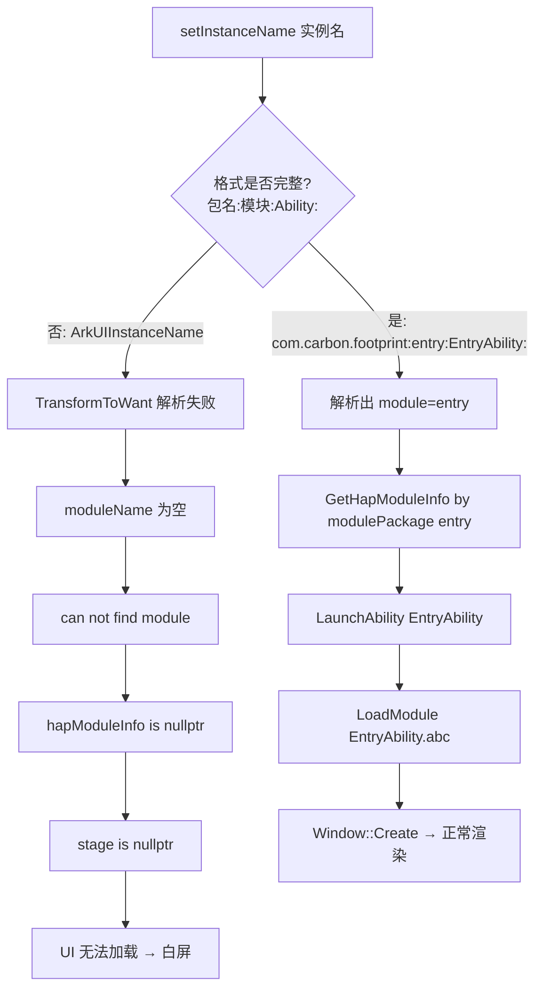

# 故障排查报告：ArkUI-X 打包 Android 应用启动白屏

> 一份可直接复用的 ArkUI-X 跨平台问题排查记录

| 项目 | 内容 |
| --- | --- |
| 文档类型 | 故障排查报告 / 根本原因分析报告（RCA） |
| 所属项目 | CarbonFootprint（碳足迹）· Android 端 |
| 问题标题 | ArkUI-X 应用安装到 Android 真机后启动白屏 |
| 发生日期 | 2026-11-17 |
| 报告版本 | v1.0 |
| 严重程度 | 阻断级（应用完全不可用，无任何 UI） |
| 当前状态 | ✅ 已解决并验证 |
| 关键词 | ArkUI-X、Android、白屏、setInstanceName、stage is nullptr、can not find module |

---

## 一、摘要（TL;DR）

ArkUI-X 工程打包成 Android APK 后，安装到真机可以正常拉起进程，但界面**全白无内容**。日志显示 ArkUI 引擎已成功加载 so、资源也已拷贝，但在加载业务页面阶段报 `can not find module`、`hapModuleInfo is nullptr, moduleName: (空)`、`stage is nullptr`。

**根本原因**：Android 壳工程的 `MainActivity.java` 中，`setInstanceName()` 保留了 SDK 模板字面量 `"ArkUIInstanceName"`，未经过 ace 工具替换为 `包名:模块名:Ability名:` 的完整格式，导致引擎无法把实例解析到 `entry` 模块，UI Ability 无法启动。

**修复**：将实例名改为完整格式 `com.carbon.footprint:entry:EntryAbility:`，重新构建 APK 后页面正常渲染。

**关键启示**：手工搭建或从模板复制的 `.arkui-x/android` 壳工程，必须核对 `setInstanceName` 是否已被替换为完整实例名，否则必然白屏。

---

## 二、环境信息

| 类别 | 版本 / 说明 |
| --- | --- |
| 设备 | 小米 23117RK66C（代号 manet），Android 14 |
| 设备连接方式 | USB 调试 + USB 安装，已授权 |
| ArkUI-X 版本 | 26.0.0.28（platform: Android） |
| OpenHarmony SDK | 26.0.0（DevEco Studio 26.0） |
| 构建工具 | `ace build apk --debug --target-platform arm64` |
| JDK | D:\jdk（JDK 17） |
| adb 路径 | `D:\aaaa\CarbonFoot\android\android-sdk\platform-tools\adb.exe` |
| 工程路径 | `D:\aaaa\CarbonFoot\android\CarbonFootprint-Android` |
| 应用包名 | `com.carbon.footprint` |
| 入口模块 / Ability | `entry` / `EntryAbility` |

---

## 三、问题现象

1. APK 通过 `adb install -r` 安装成功，返回 `Success`。
2. 启动应用后，**进程存活、窗口在前台**，但屏幕**完全空白**，没有任何 UI 元素，也没有明显的崩溃弹窗。
3. 这种"进程活着但没内容"的表现，说明不是安装或权限问题，而是 **UI 渲染链路** 在某一步中断。

---

## 四、排查过程（完整时间线）

### 阶段 0：先排除运行环境问题

在怀疑代码之前，先确认应用确实被正确拉起：

```bash
# 1. 确认设备被识别（状态为 device 而非 unauthorized）
adb devices -l
# 输出：bc6a8c4c  device product:manet model:23117RK66C ...

# 2. 确认进程存活、窗口在前台
adb shell pidof com.carbon.footprint          # 有 PID 输出
adb shell dumpsys window | grep mCurrentFocus # 指向 com.carbon.footprint/.MainActivity
```

结论：设备、安装、拉起、进程均正常，问题在应用内部。

> 💡 排障原则：先分层定位（设备层 → 安装层 → 进程层 → 渲染层），避免在错误层面浪费时间。

### 阶段 1：抓取应用进程日志，锁定错误

为了避免系统日志噪音淹没有效信息，采用"清空 → 重启 → 按 PID 精确过滤"的方法：

```bash
adb logcat -c                                      # 清空日志
adb shell am force-stop com.carbon.footprint        # 停止应用
adb shell monkey -p com.carbon.footprint \
    -c android.intent.category.LAUNCHER 1           # 重新启动
sleep 6
PID=$(adb shell pidof com.carbon.footprint)         # 取当前 PID
adb logcat -d | grep "^.{0,40}[[:space:]]${PID}[[:space:]]" \
    | grep -i -E "ace|arkui|error|fail|module|stage|js"
```

**关键错误链**（这是本次问题的核心证据）：

```
E Ace : [inner_bundle_info.cpp(777)] can not find module
E Ace : [application.cpp(102)] hapModuleInfo is nullptr, moduleName:
E Ace : [application.cpp(143)] stage is nullptr
```

同时注意到引擎打印的实例名：

```
I Ace : [app_main.cpp(424)] HandleDispatchOnCreate called, instanceName: ArkUIInstanceName1
I Ace : [app_main.cpp(570)] TransformToWant::str : ArkUIInstanceName1
```

**初步判断**：实例名解析不出模块 → `moduleName` 为空 → 找不到模块信息 → Stage 创建失败 → 页面无法加载。

### 阶段 2：排除"资源缺失"假设

日志里还有一条误导性错误：

```
E StageApplicationDelegate: read or write data err: arkui-x/arkui-x.json/resources.index
```

检查 APK 内资源与运行时拷贝结果：

```bash
# APK 内资源清单（关键文件均在）
unzip -l 碳足迹-debug.apk | grep -E "arkui-x.json|module.json|modules.abc|resources.index"
# assets/arkui-x/arkui-x.json
# assets/arkui-x/entry/module.json
# assets/arkui-x/entry/ets/modules.abc
# assets/arkui-x/entry/resources.index

# 运行时 files 目录（资源已成功拷贝）
adb shell run-as com.carbon.footprint ls -R files/arkui-x
# entry/ entry_test/ systemres/ 及其下 resources、rawfile 均在
```

结论：`read or write data err` 是引擎尝试把 `arkui-x.json` 当目录复制资源的无害报错，资源本身完整。**排除资源缺失**。

`arkui-x.json` 与 `entry/module.json` 内容也核对过，配置正确（`bundleName=com.carbon.footprint`、`name=entry`、`mainElement=EntryAbility`、`packageName=entry`）。

### 阶段 3：排除"旧 APK 配置不同步"假设

注意到旧 APK 构建于 14:19，而工程源码是 15:48 的版本，怀疑是旧产物。于是重新构建并安装：

```bash
cd D:\aaaa\CarbonFoot\android\CarbonFootprint-Android
export PATH="/d/aaaa/CarbonFoot/android/arkui-x-sdk-26/26.0.0/arkui-x/toolchains/bin:$PATH"
export ANDROID_HOME="D:/aaaa/CarbonFoot/android/android-sdk"
export ANDROID_SDK_ROOT="D:/aaaa/CarbonFoot/android/android-sdk"
export JAVA_HOME="D:/jdk"
unset NODE_OPTIONS          # 重要：ace build 时绝不能设置 NODE_OPTIONS
ace build apk --debug --target-platform arm64
```

结果：`BUILD SUCCESSFUL`，但**错误依旧**。排除旧产物问题，确认是工程配置本身的问题。

### 阶段 4：定位到壳工程的实例名配置

阅读 Android 壳工程源码：

```java
// .arkui-x/android/app/src/main/java/MainActivity.java
public class MainActivity extends StageActivity {
    @Override
    protected void onCreate(Bundle savedInstanceState) {
        Log.e("HiHelloWorld", "MainActivity");
        setInstanceName("ArkUIInstanceName");   // ← 可疑：SDK 模板字面量
        super.onCreate(savedInstanceState);
    }
}
```

同时核对：SDK 模板 `templates/android/app/src/main/java/MainActivity.java` 里写的也是 `setInstanceName("ArkUIInstanceName")`。

**关键疑问**：模板里是占位符，说明它应该在构建时被工具替换。为什么这里还是字面量？

### 阶段 5：从 ace 工具源码找到决定性证据

在 SDK 的 `ace_tools.js` 中搜索 `ArkUIInstanceName`，找到构建时的替换逻辑：

```javascript
// ace_tools.js —— 构建 Android 壳工程时替换实例名
WM.readFileSync(h).toString().replace(
    new RegExp("ArkUIInstanceName", "g"),
    a.app.bundleName + ":" + e + ":" + t + ":"
)

// 另一处等价逻辑
uB.writeFileSync(d, uB.readFileSync(d).toString().replace(
    new RegExp("ArkUIInstanceName", "g"),
    i + ":" + e + ":" + TB(e) + "Ability:"
))
```

即：**正常的 ace 构建会把 `ArkUIInstanceName` 替换为 `包名:模块名:Ability名:` 格式**，例如：

```
com.carbon.footprint:entry:EntryAbility:
```

而本工程的 `.arkui-x/android` 壳工程是手工搭建/复制模板而来，**从未经过 ace 工具的这一步替换**，因此字面量被原样编译进 APK。引擎拿到 `ArkUIInstanceName` 无法解析出 `entry` 模块，直接导致白屏。

---

## 五、根本原因分析

### 机制说明

ArkUI-X 的 Stage 模型通过"实例名"来定位要加载的 UI Ability。实例名是一个四段式结构：

```
<bundleName> : <moduleName> : <abilityName> : <instanceId>
com.carbon.footprint : entry : EntryAbility : 1
```

引擎启动时，用前三段解析出模块和 Ability，进而加载 `entry/ets/entryability/EntryAbility.abc` 并创建 Stage/Window。



### 根因结论

| 层面 | 结论 |
| --- | --- |
| 直接原因 | `setInstanceName()` 使用了未替换的模板字面量 `ArkUIInstanceName` |
| 深层原因 | Android 壳工程为手工搭建，跳过了 ace 工具生成壳工程时的实例名替换步骤 |
| 为何鸿蒙端正常 | 鸿蒙 HAP 由 DevEco 正常构建，Ability 由系统按 module.json 直接拉起，不依赖 Android 壳的实例名解析 |

---

## 六、解决方案

修改 `MainActivity.java`，把实例名改成 ace 工具本应替换成的完整格式：

```diff
- setInstanceName("ArkUIInstanceName");
+ setInstanceName("com.carbon.footprint:entry:EntryAbility:");
```

然后重新构建、安装：

```bash
ace build apk --debug --target-platform arm64
adb install -r app-debug.apk
```

> 注意：末尾的冒号 `:` 需要保留（用于分隔可空的 instanceId 段，引擎会自动补 `1`）。
> 替换后文件中不再含有 `ArkUIInstanceName` 字面量，因此后续 ace 构建不会再次改动它。

---

## 七、验证结果

修复后重新抓取日志，错误链消失，加载链路完整：

```
# 实例名被正确解析为四段
I Ace : HandleDispatchOnCreate called, instanceName: com.carbon.footprint:entry:EntryAbility:1
I Ace : TransformToWant::str : com.carbon.footprint
I Ace : TransformToWant::str : entry
I Ace : TransformToWant::str : EntryAbility
I Ace : TransformToWant::str : 1

# 找到模块、启动 Ability、加载 JS 代码、创建窗口
I Ace : BundleContainer GetHapModuleInfo by modulePackage entry
I Ace : LaunchAbility ability name: EntryAbility, hapPath: arkui-x/entry/
I Ace : moduleName: entry abilityName: EntryAbility
I Ace : JsRuntime::LoadModule(entry::EntryAbility, entry/ets/entryability/EntryAbility.abc
I Ace : Window::Create called. windowName=com.carbon.footprint:entry:EntryAbility:1
```

最终状态检查：

| 检查项 | 结果 |
| --- | --- |
| `can not find module` / `stage is nullptr` | 已消失 ✅ |
| JS 运行时错误 | 无 ✅ |
| 进程状态 | 存活（PID 正常）✅ |
| 前台窗口 | 指向 `.MainActivity` ✅ |
| 界面渲染 | 正常显示 ✅ |

---

## 八、经验总结与避坑指南

1. **手工搭壳必须核对实例名**：从模板复制的 `.arkui-x/android` 工程，`setInstanceName("ArkUIInstanceName")` 是占位符，必须替换为 `包名:模块:Ability:`。优先使用 ace 工具自动生成壳工程，避免手工搭建。

2. **白屏 ≠ 崩溃**：进程存活但无 UI，优先看 `Ace`/`StageApplicationDelegate` 标签的日志，而不是 `AndroidRuntime` 崩溃栈。

3. **按 PID 过滤日志**：小米等定制系统会刷大量噪音日志，用 `pidof` 取 PID 后过滤，效率提升明显。

4. **识别无害报错**：`read or write data err: arkui-x.json/resources.index`、`FEKit_dtc`、`MediaProvider`、`PhoneAdapter` 等均为系统或其他应用噪音，不要误判为根因。

5. **ace build 时不要设置 `NODE_OPTIONS`**：会导致 hvigor websocket 断开、报 `Specification Limit Violation`。构建前 `unset NODE_OPTIONS`。

6. **APK 文件名避免中文**：adb 处理中文路径有编码风险，安装前复制成 `app-debug.apk` 等英文名。

7. **排除法要成体系**：本次依次排除了运行层（设备/安装/进程）、资源层（文件完整性）、产物层（新旧包），最后锁定配置层，避免盲目改代码。

---

## 九、附录

### 9.1 常用命令速查

```bash
# 设备与安装
adb devices -l
adb install -r app-debug.apk
adb shell pm list packages | grep carbon

# 启动与停止
adb shell am force-stop com.carbon.footprint
adb shell monkey -p com.carbon.footprint -c android.intent.category.LAUNCHER 1

# 日志定位三件套
adb logcat -c
PID=$(adb shell pidof com.carbon.footprint)
adb logcat -d | grep "^.{0,40}[[:space:]]${PID}[[:space:]]"

# 前台窗口
adb shell dumpsys window | grep mCurrentFocus

# 构建
export PATH="/d/aaaa/CarbonFoot/android/arkui-x-sdk-26/26.0.0/arkui-x/toolchains/bin:$PATH"
export ANDROID_HOME="D:/aaaa/CarbonFoot/android/android-sdk"
export ANDROID_SDK_ROOT="D:/aaaa/CarbonFoot/android/android-sdk"
export JAVA_HOME="D:/jdk"
unset NODE_OPTIONS
ace build apk --debug --target-platform arm64
```

### 9.2 关键文件清单

| 文件 | 作用 |
| --- | --- |
| `.arkui-x/android/app/src/main/java/MainActivity.java` | 定义 `setInstanceName`，本次修复点 |
| `.arkui-x/android/app/src/main/java/MyApplication.java` | 应用入口 `StageApplication` |
| `.arkui-x/android/app/src/main/AndroidManifest.xml` | Activity 与权限声明 |
| `.arkui-x/arkui-x-config.json5` | 声明参与构建的模块（`modules: ["entry"]`） |
| `AppScope/app.json5` | 应用 bundleName / 版本信息 |
| `entry/src/main/module.json5` | 模块与 Ability 声明 |
| `<SDK>/ace_tools/lib/ace_tools.js` | 含实例名替换逻辑，根因证据来源 |

### 9.3 日志关键词对照表

| 日志关键词 | 含义 | 是否严重 |
| --- | --- | --- |
| `can not find module` | 引擎找不到模块 | ❌ 严重（本次根因） |
| `hapModuleInfo is nullptr` | 模块信息为空 | ❌ 严重 |
| `stage is nullptr` | Stage 创建失败，UI 无法加载 | ❌ 严重 |
| `TransformToWant::str : <值>` | 引擎解析实例名的各段 | 👀 排查重点 |
| `read or write data err: arkui-x.json/resources.index` | 复制资源时的无害报错 | ✅ 可忽略 |
| `FEKit_dtc` / `MediaProvider` / `PhoneAdapter` | 系统/QQ 噪音日志 | ✅ 可忽略 |
| `LaunchAbility` / `LoadModule` / `Window::Create` | 加载成功标志 | ✅ 正常 |

### 9.4 参考资料

- ArkUI-X 构建 Android 应用文档（SDK 内置模板注释中引用的 gitee 文档）
- SDK 内置模板：`arkui-x-sdk-26/.../ace_tools/templates/android/`
- ace 工具源码：`arkui-x-sdk-26/.../ace_tools/lib/ace_tools.js`

---

*本文档记录的问题已解决。如遇同类白屏问题，请先核对实例名配置，再按第四章的排查流程逐层定位。*
